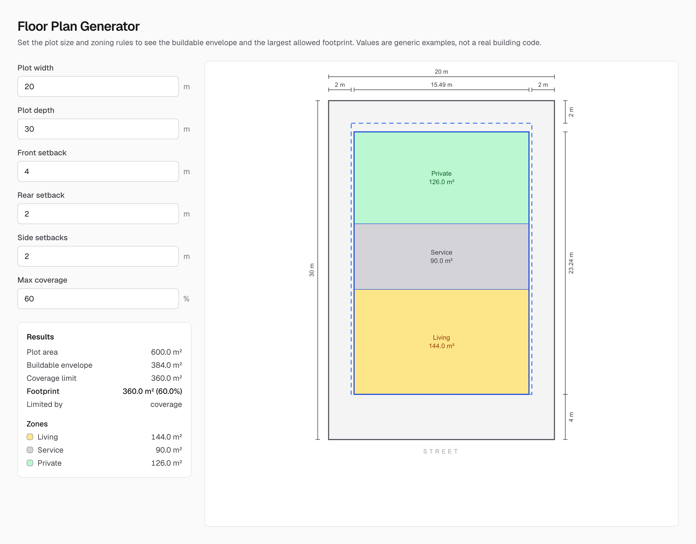

# Floor Plan Generator

A small rule-based 2D layout tool built with Next.js. Enter a plot size and simple zoning rules (front, rear and side setbacks, max building coverage) and the canvas shows the plot, the setback lines, the buildable envelope, the largest footprint the rules allow with its dimensions, and a simple split of that footprint into living, service and private zones. Everything updates as you type.



The rule values are generic examples and don't claim compliance with any real building code.

## Stack

- Next.js (App Router) + TypeScript
- Tailwind CSS
- react-konva for the canvas
- zod for input validation
- Vitest for the rule functions

## How it works

All zoning logic lives in pure functions in [`src/lib/rules.ts`](src/lib/rules.ts):

- `computeEnvelope` subtracts the setbacks from the plot.
- `computeFootprint` takes the envelope and, if it exceeds the coverage limit, scales it down (keeping proportions) and places it against the front setback line.
- `computeZones` splits the footprint into full-width bands across its depth: living faces the street, service sits in the middle and private is at the rear. The shares (40 / 25 / 35 % of the depth) are in `ZONE_SHARES`.
- `computePlan` runs all of these and returns a result or a readable error.

The UI only validates input and draws what these functions return (dimension chains along the top and right edges show the setbacks and the footprint size), so the rules are easy to test and extend.

## Getting started

```bash
npm install
npm run dev     # http://localhost:3000
npm test        # rule unit tests
```

## Roadmap

- [x] Plot, setbacks, buildable envelope and coverage-limited footprint
- [x] Simple zone split (living / service / private)
- [x] Dimension labels for setbacks and footprint
- [ ] Pan and zoom
